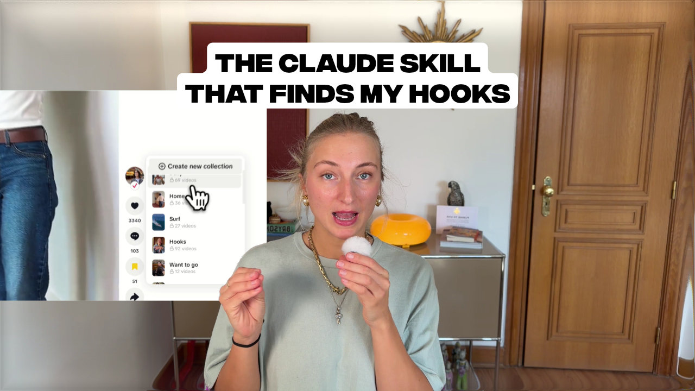

# TikTok & Instagram Hooks for Claude

Save the first 2–3 spoken sentences and actual opening frame from TikTok videos and Instagram Reels/video posts to **Obsidian, Notion, or plain Markdown**.

- Save individual TikTok and Instagram video links
- Sync unseen videos from a private **TikTok** collection
- Choose Obsidian notes with table/gallery views, a single Markdown file, or a Notion parent page
- Transcribe locally with Whisper; no paid transcription API is required
- Read login access from an existing browser session, without copying cookies into configuration
- Optionally schedule daily TikTok collection syncs on macOS

[Hookline](https://hookline-blue.vercel.app/) is the separate, zero-install public TikTok demo. Its browser library does not sync with this skill. This repository contains the local skill, not the web app; these Instagram and destination features require installing the updated skill.

## Watch the tutorial

[](https://www.tella.tv/video/build-a-claude-skill-for-content-hooks-full-tutorial-169-aey6ei8n)

## Requirements and install

- macOS, Python 3.10+, and `ffmpeg` (`brew install ffmpeg`)
- For videos that require login: Chrome, Chromium, Brave, Edge, Firefox, Safari, Opera, or Vivaldi logged into the relevant platform. Arc is not supported.
- For Notion: a Notion internal connection token, shared with the hooks database or its parent page

Install or update from a checkout:

```bash
git clone https://github.com/louisedesadeleer/tiktok-hooks.git
cd tiktok-hooks
bash install.sh
```

For an existing checkout, pull the latest changes before running `bash install.sh` again. Configuration and saved hooks are preserved. The installer copies the skill to `~/.claude/skills/tiktok-hooks` and creates an isolated Python environment at `~/.local/share/tiktok-hooks/venv` with `yt-dlp` and Whisper. It does not install `ffmpeg` or Homebrew; it ends by running the requirements check below.

Check what's installed at any time:

```bash
python3 scripts/doctor.py
```

It lists macOS, Python 3.10+, Homebrew, ffmpeg, the skill files, Whisper and yt-dlp, the Whisper model, and your configuration, with the command to fix anything missing. Homebrew is only needed to install ffmpeg (`brew install ffmpeg`).

Then ask Claude:

> Set up my TikTok hooks skill. Save to Obsidian.

or:

> Set up my TikTok hooks skill. Save to Notion.

The installed skill name and configuration directories remain `tiktok-hooks` for compatibility. Existing configurations continue using their current Markdown layout.

## Choose your destination

### Obsidian

Choose a `.md` path inside your vault. Obsidian defaults to one note per hook, with an opening image, transcript, creator, platform, source, save date, and video ID. A `.base` file offers table and gallery views and is never overwritten.

```bash
~/.local/share/tiktok-hooks/venv/bin/python \
  ~/.claude/skills/tiktok-hooks/scripts/configure.py \
  --destination obsidian \
  --markdown-path "~/Documents/MyVault/Video Hooks.md"
```

Use `--layout single` to save to one Markdown file instead. For a folder outside Obsidian, choose `--destination markdown --markdown-path "~/Documents/Video Hooks.md"`.

### Notion

1. Create an internal connection in [Notion's integrations settings](https://www.notion.so/profile/integrations), with read, insert, and update content capabilities.
2. Hooks are saved to a **database**, one row per hook. Either let Claude create a "Video Hooks" database with its Notion connector, or create one yourself, or let the script create it inside a page (below).
3. Add your connection to the database (or its parent page) through ••• → Connections.
4. Run one of these in your own terminal. The token prompt is hidden; never paste your token into chat or commit it to Git.

```bash
# Use an existing database
~/.local/share/tiktok-hooks/venv/bin/python \
  ~/.claude/skills/tiktok-hooks/scripts/configure.py \
  --destination notion \
  --notion-database "https://www.notion.so/your-database-id" \
  --set-notion-token

# Or create a "Video Hooks" database inside a page
~/.local/share/tiktok-hooks/venv/bin/python \
  ~/.claude/skills/tiktok-hooks/scripts/configure.py \
  --destination notion \
  --notion-page "https://www.notion.so/your-page-id" \
  --notion-create-database \
  --set-notion-token
```

Database columns: the skill fills these columns when they exist with these types: `Hook` (text), `Creator` (text), `Platform` (select), `Source` (URL), `Saved` (date) and `Video ID` (text); the title column is filled whatever it is named, and missing columns are skipped. Each row's page body holds the opening image, so a gallery view with *Card preview: Page content* shows it. Without a `Video ID` column, the `[hook:…]` marker stays in the title for retry deduplication. A database has its own duplicate tracking, so switching to one re-imports the initial collection batch there.

With `--notion-page` alone (no database), each hook instead becomes a child page. In both cases the hook's page body holds its opening JPEG uploaded to Notion, the spoken hook, metadata, and a source bookmark. The transcript and opening image are sent to Notion; transcription still runs locally. No public image hosting is needed.

The token is stored separately from configuration at `~/.config/tiktok-hooks/notion-token`, with owner-only file permissions. This file lets scheduled syncs work without an open terminal. `--notion-token-file` chooses another location. Alternatively, provide `NOTION_TOKEN` in the process environment for a manual run; shell environment variables are not automatically inherited by `launchd`.

Choosing Notion does not need a Markdown path. Previously saved local hooks are left in place. Duplicate tracking is independent for the local destination, each Notion parent page, and each Notion database. Switching destinations does not bulk-copy existing hooks: submit their URLs again, or sync the configured initial collection batch. Notion page titles include a stable `[hook:…]` marker so a retry can recover after a lost server response; preserve that marker. `--force` is only available for local output; edit existing Notion hook pages directly.

## Save a video

> Save this TikTok hook: https://www.tiktok.com/@creator/video/123

> Save this Instagram hook: https://www.instagram.com/reel/SHORTCODE/

Or run:

```bash
~/.local/share/tiktok-hooks/venv/bin/python \
  ~/.claude/skills/tiktok-hooks/scripts/sync.py \
  --url "https://www.instagram.com/reel/SHORTCODE/"
```

Instagram supports individual Reels and single-video `/p/` or `/tv/` posts. Instagram saved collections, profiles, photo posts, and multi-item carousels are not supported. Instagram may require login even for public videos. Configure `--browser chrome` (or another supported browser) to use your existing login. A single configured browser is used for both platforms, so log into both there if needed. Access depends on what your account can view and on `yt-dlp` support; restricted or unavailable videos may fail.

Both platforms share the extraction pipeline: download temporarily, capture the first frame with `ffmpeg`, transcribe up to the first 60 seconds with local Whisper, then keep the first two sentences (three if the first two contain fewer than 12 words). This transcribes speech, not text displayed on screen. Instagram and TikTok IDs are kept separate to avoid duplicate or image-name collisions.

## TikTok collection sync and scheduling

> Sync my TikTok hook collection.

Setup asks for the collection URL, logged-in browser, and initial import size (default five). Each sync checks up to the configured number of newest entries (default 30), skips already saved videos, and retries failed videos that are still in that checked window. The first sync deliberately skips the remaining initial backlog; an explicit URL can still import one of those videos.

> Schedule my TikTok hook collection to sync every morning at 9.

After a successful manual sync, the optional macOS `launchd` job runs Python directly. Claude need not stay open. The Mac needs network access and an opportunity to run the job. For Notion, configure a token file before scheduling. There is no automatic Instagram collection sync.

## Local data

```text
~/.config/tiktok-hooks/
  config.json
  notion-token                 # only if you use --set-notion-token
~/.local/share/tiktok-hooks/
  seen.json
  sync.lock
  logs/
  venv/
  assets/                      # opening images for Notion output
<markdown directory>/
  Video Hooks.md               # single-file layout
  Video Hooks/                 # notes layout
  Video Hooks.base             # notes layout
  assets/tiktok-hooks/          # opening images for local output
```

Downloaded videos and temporary audio are removed at the end of processing. Opening images, output, configuration, and duplicate-tracking state persist locally. Browser cookies are read by `yt-dlp` and are not copied into the configuration or output. The Notion token is never included in `configure.py --show` output.

## Development

```bash
python3 -m unittest discover -s tests
uvx ruff check --target-version py310 .
bash -n install.sh
```

Tests use mocked platform metadata and Notion API responses. Live extraction depends on platform access, and a live Notion test requires a token and a shared test page.

## Uninstall

```bash
bash ~/.claude/skills/tiktok-hooks/uninstall.sh
```

Removes the daily sync, the skill files, the Python environment (Whisper and yt-dlp), configuration, the Notion token, sync state, and the Whisper model cache, after asking you to confirm (`--yes` skips the question; `--keep-whisper-model` keeps the model). Your saved hooks, ffmpeg, and Homebrew stay. Delete the Notion connection at [notion.so/profile/integrations](https://www.notion.so/profile/integrations) and any hooks database in Notion yourself.
